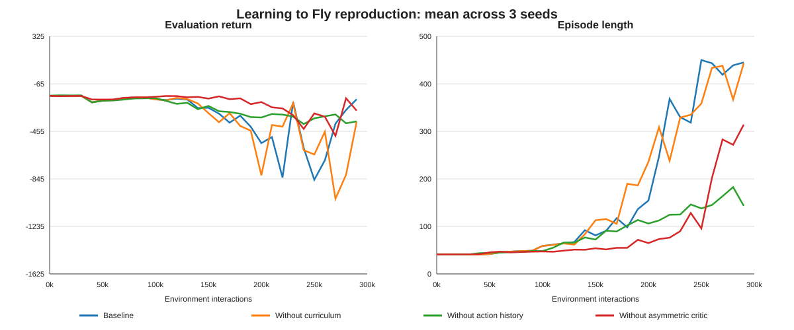
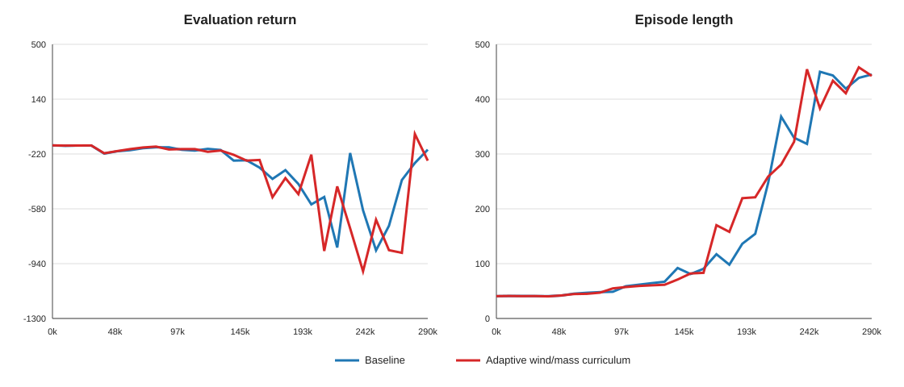
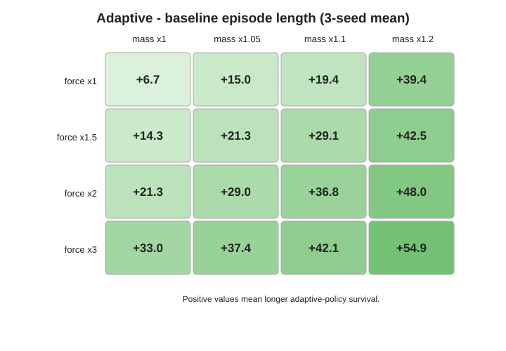

# Learning to Fly 재현 및 Adaptive Curriculum 실험 보고서

작성일: 2026-10-24  
범위: PPT 재현 계획 점검, 12개 baseline/ablation 분석, 두 번째 개선안 구현, 3-seed 학습 및 baseline 비교

## 1. 결론 요약

PPT에서 계획한 12개 학습은 모두 완료됐다. Baseline과 세 가지 ablation에 대해 각각 seed 0, 1, 2가 있으며, 모든 실행에 300k checkpoint가 존재한다. 비교에는 모든 실행에 공통으로 남아 있는 마지막 TensorBoard 평가점인 290k를 사용했다.

재현 실험에서는 action history의 중요성이 가장 분명했다. Action history를 제거하면 최종 episode length가 baseline 대비 약 68% 감소했다. Asymmetric critic 제거는 seed 간 분산을 크게 키웠다. 반면 기존 fixed curriculum의 효과는 3 seeds, 300k 범위에서 분명하지 않았다.

두 번째 개선안으로 performance-adaptive wind/mass curriculum을 별도 폴더에 구현하고 seed 0, 1, 2를 모두 학습했다. 결과는 **일부 seed에서는 개선됐지만, 3-seed 평균 기준으로 baseline을 개선하지 못했다.** 290k에서 adaptive 방식은 baseline보다 평균 return이 72.31 낮았고, 평균 episode length가 2.46 짧았다. seed 0과 1은 두 지표 모두 개선됐지만 seed 2의 성능 하락이 컸다. 따라서 현재 구현을 “baseline 대비 개선 완료”라고 판단할 수 없다.

후속 v2에서는 조기 승급 방지, force/mass 단계 분리, rollback을 구현해 3 seeds를 다시 학습했다. 동일 290k budget에서 episode length는 451.46 ± 6.12로 baseline보다 높고 훨씬 안정적이었지만 return은 낮았다. Stress 평가에서도 300k v2는 생존성, 400k v2는 위치 정밀도에 각각 강점을 보여 **한 정책이 모든 지표에서 baseline을 이기지는 못했다.** 현재 핵심 문제는 환경 강도가 부족한 것이 아니라 nominal 정밀도와 stress 생존성을 동시에 보존하는 gate가 없다는 점이다.

## 2. 재현 계획 점검

| 계획 항목 | 결과 |
|---|---|
| 공식 TD3 및 simulator 사용 | 완료 |
| Baseline, seeds 0–2 | 완료 |
| Without curriculum, seeds 0–2 | 완료 |
| Without action history, seeds 0–2 | 완료 |
| Without asymmetric critic, seeds 0–2 | 완료 |
| 300k checkpoint 저장 | 12/12 완료 |
| Episode return/length 저장 | 완료 |
| Wall-clock time 저장 | 완료 |
| Seed 간 mean ± sample std | 완료 |
| 명시적 수렴 기준 평가 | 완료 |
| 3M interactions 확장 | 미실행, 선택 항목 |

Baseline seed 0의 중복 실행 하나는 제외하고, configuration과 seed가 같은 경우 가장 최신 실행을 선택했다.

## 3. 분석 기준

- 학습 평가 주기: 10k interactions
- 공통 최종 평가점: 290k
- 학습 종료 및 최종 checkpoint: 300k
- 평가당 episodes: 1,000
- 엄격한 수렴 기준: `episode_length_mean >= 475`를 두 평가점 연속 만족
- 보조 기준: episode length 400 및 450 최초 도달 step

300k 평가는 기존 TensorBoard 로그에 공통으로 flush되지 않았으므로 공정한 비교를 위해 290k를 사용했다.

## 4. 기존 재현 결과

### 4.1 290k 성능

표의 ±는 세 random seeds 사이의 sample standard deviation이다.

| 구성 | Episode length | Evaluation return | 엄격 수렴 seeds |
|---|---:|---:|---:|
| Baseline | 445.0 ± 15.4 | -191.4 ± 373.5 | 0/3 |
| Without curriculum | 443.1 ± 24.4 | -376.1 ± 569.6 | 0/3 |
| Without action history | 143.4 ± 26.0 | -372.7 ± 28.7 | 0/3 |
| Without asymmetric critic | 314.2 ± 206.0 | -284.7 ± 255.3 | 0/3 |

### 4.2 해석

- Action history 제거는 세 seed 모두 큰 성능 하락을 일으켰다. 논문의 핵심 경향이 강하게 재현됐다.
- Asymmetric critic 제거는 일부 seed가 학습하지만 일부 seed가 실패해 안정성 기여가 부분적으로 재현됐다.
- Fixed curriculum 제거 결과는 baseline과 episode length가 거의 같았다. 이 실험 범위에서는 기존 curriculum의 우위를 확인하지 못했다.
- 어떤 구성도 엄격한 수렴 기준을 만족하지 못했다. 따라서 “300k 이내 완전 수렴”의 강한 재현 주장은 할 수 없다.

## 5. 두 번째 개선안 설계

기존의 고정 100k-step 전환 대신 nominal validation 성능으로 stage를 올린다.

| 승급 | Episode length | Mean position error |
|---|---:|---:|
| Stage 0 → 1 | ≥100 | ≤0.45 m |
| Stage 1 → 2 | ≥300 | ≤0.35 m |
| Stage 2 → 3 | ≥450 | ≤0.25 m |

Validation은 25k마다 실행하고, 최소 stage 체류 시간은 50k이며, 같은 기준을 두 번 연속 통과해야 승급한다.

| Stage | External-force std | Episode mass factor | Reward level |
|---|---:|---:|---:|
| 0 | baseline ×1.0 | 1.00 | initial |
| 1 | baseline ×1.5 | Uniform(1.00, 1.05) | promotion 1 |
| 2 | baseline ×2.0 | Uniform(1.00, 1.10) | promotion 2 |
| 3 | baseline ×3.0 | Uniform(1.00, 1.20) | promotion 2 유지 |

여기서 wind는 풍속을 입력하는 공기역학 모델이 아니라, 기존 simulator가 episode 시작 시 샘플링해 episode 동안 유지하는 3축 외력이다. 보고서에서는 이를 `wind-equivalent constant external disturbance`로 해석한다. Nominal mass는 0.027 kg이며, mass는 episode reset 때 별도 curriculum RNG로 샘플링한다. Validation과 일반 evaluation은 nominal 조건으로 유지했다.

## 6. Adaptive 3-seed 실행 결과

### 6.1 Stage 전환

| Seed | Stage 0 → 1 | Stage 1 → 2 | 최종 stage | 학습 시간 |
|---:|---:|---:|---:|---:|
| 0 | 275k | 미도달 | 1 | 81.82 s |
| 1 | 200k | 275k | 2 | 169.99 s |
| 2 | 200k | 미도달 | 1 | 87.53 s |

seed 2는 200k에서 episode length 103.5, position error 0.421로 첫 gate를 간신히 통과했다. 이후 강화된 외력 및 mass 조건에서 성능 변동이 커졌고 Stage 2에 도달하지 못했다. seed 1의 실행 시간이 긴 것은 더 긴 episode가 일찍 형성되고 validation을 추가로 수행한 영향이 함께 반영된 값이다.

### 6.2 290k에서 baseline과 짝지은 비교

| Seed | Baseline return | Adaptive return | Δ return | Baseline length | Adaptive length | Δ length |
|---:|---:|---:|---:|---:|---:|---:|
| 0 | -154.28 | -92.84 | +61.44 | 444.36 | 473.91 | +29.55 |
| 1 | 162.11 | 325.58 | +163.46 | 429.93 | 438.90 | +8.97 |
| 2 | -582.05 | -1023.89 | -441.84 | 460.71 | 414.81 | -45.90 |
| **3-seed 평균** | **-191.40** | **-263.72** | **-72.31** | **445.00** | **442.54** | **-2.46** |

Seed 간 sample std도 악화됐다.

| 지표 | Baseline std | Adaptive std |
|---|---:|---:|
| Evaluation return | 373.47 | 690.77 |
| Episode length | 15.40 | 29.71 |

Episode-length learning-curve AUC는 baseline 161.15에서 adaptive 168.38로 4.5% 증가했다. 다만 분산이 21.09에서 46.30으로 커졌고, 최종 성능 평균은 개선되지 않았다. 엄격 수렴 기준은 두 방식 모두 0/3 seeds였다.

## 7. 개선 여부 판정

### 7.1 외력 × 질량 stress grid

Baseline과 adaptive의 300k checkpoint를 외력 `{1.0, 1.5, 2.0, 3.0}` × mass `{1.0, 1.05, 1.10, 1.20}`의 16개 조합에서 평가했다. 각 checkpoint·조건마다 1,000 episodes, 총 96,000 episodes를 사용했다. 같은 seed에는 모든 정책과 stress 조건에서 동일한 초기 상태 및 표준 disturbance 표본을 적용했다.

Nominal을 제외한 15개 stress 조건의 평균은 다음과 같다.

| 지표 | Baseline | Adaptive | 변화 |
|---|---:|---:|---:|
| Episode length | 376.04 | 408.28 | +32.24 (+8.6%) |
| 500-step 생존율 | 70.00% | 79.53% | +9.53%p |
| Mean position error | 0.3048 m | 0.3252 m | +0.0204 m (악화) |
| Return/step | -0.972 | -1.293 | -0.321 (악화) |

Adaptive는 16/16 조건에서 episode length와 생존율이 baseline보다 높았다. 반대로 position error와 return/step은 단 한 조건에서도 개선되지 않아, 모든 조건에서 baseline보다 나빴다.

가장 강한 `force ×3, mass ×1.2` 조건에서는 episode length가 309.22에서 364.10으로 54.88 증가했고, 생존율은 53.07%에서 69.47%로 16.40%p 증가했다. 그러나 position error는 0.3212 m에서 0.3459 m로 악화됐다.

### 7.2 최종 판정

현재 결과의 판정은 다음과 같다.

- **개별 성공:** seed 0과 1은 290k return과 episode length가 모두 개선됐다.
- **평균 실패:** 세 seed 평균에서는 return과 episode length 모두 baseline보다 낮다.
- **안정성 실패:** seed 간 분산이 두 지표 모두 증가했다.
- **수렴 개선 없음:** `475 이상 × 2회 연속`을 만족한 seed는 여전히 없다.
- **생존 강건성 개선:** 모든 stress 조건에서 episode length와 생존율이 개선됐다.
- **제어 정밀도 악화:** 모든 조건에서 position error와 step당 reward가 악화됐다.

따라서 이 구현은 **추락하지 않고 버티는 능력은 개선했지만, 위치를 정밀하게 유지하는 종합 제어 성능은 개선하지 못했다.** 단순 실패/생존이 목표라면 유효한 개선이지만, 안정적인 hover 품질까지 목표라면 아직 불완전하다. 낮은 첫 gate를 간신히 넘은 정책에도 외력과 mass 난이도를 동시에 올리는 것, 그리고 reward 변경까지 같은 승급에 묶인 것이 정밀도 저하의 원인 후보다.

## 8. Adaptive curriculum v2 결과

v1 결과에 따라 별도 `experiments/adaptive_curriculum_v2` 폴더에서 다음을 변경했다.

- Stage 0 승급 기준을 length 250, position error 0.40 m, return/step -1.0으로 강화
- 25k validation을 3회 연속 통과해야 승급
- `force-only → mass 추가 → force와 mass 동시 증가`로 stage 분리
- retention 기준을 2회 연속 실패하면 이전 stage로 rollback
- 300k checkpoint를 보존하고, 승급 이후를 관찰하기 위해 v2만 400k까지 확장

Stage 전환은 다음과 같았다.

| Seed | Stage 0 → 1 | Stage 1 → 2 | 최종 stage |
|---:|---:|---:|---:|
| 0 | 325k | 미도달 | 1 |
| 1 | 225k | 325k | 2 |
| 2 | 미도달 | 미도달 | 0 |

seed 2의 v1 조기 승급은 방지됐다. 세 실행 모두 rollback은 발생하지 않았다.

### 8.1 동일 budget 비교

공통 290k TensorBoard 평가에서는 v2가 episode length 평균과 seed 안정성을 개선했지만 return은 개선하지 못했다.

| 구성 | Episode length | Evaluation return |
|---|---:|---:|
| Baseline 290k | 445.00 ± 15.40 | -191.40 ± 373.47 |
| Adaptive v1 290k | 442.54 ± 29.71 | -263.72 ± 690.77 |
| Adaptive v2 290k | 451.46 ± 6.12 | -269.53 ± 753.76 |

v2의 episode length는 baseline보다 6.46 높고 seed 표준편차는 약 60% 감소했다. 그러나 return 평균과 분산은 baseline보다 나빴다.

### 8.2 Stress grid 비교

Nominal을 제외한 15개 조건의 3-seed 평균이다.

| 구성 | Length | 생존율 | Position error | Return/step |
|---|---:|---:|---:|---:|
| Baseline 300k | 376.04 | 70.00% | 0.3048 m | -0.972 |
| Adaptive v1 300k | 408.28 | 79.53% | 0.3252 m | -1.293 |
| Adaptive v2 300k | 412.03 | 80.37% | 0.3308 m | -1.266 |
| Adaptive v2 400k | 352.88 | 66.07% | 0.2676 m | -0.888 |

v2 300k는 16/16 조건에서 baseline보다 length와 생존율이 높았다. v1보다도 평균 length가 3.75, 생존율이 0.84%p 높고 seed 분산이 작았다. 하지만 position error는 모든 조건에서 baseline보다 나빴다.

v2 400k는 반대 결과를 보였다. Position error는 16/16 조건에서 baseline보다 낮았고 return/step은 11/16 조건에서 높았다. 그러나 length는 1/16, 생존율은 2/16 조건에서만 baseline보다 높았다. 추가 학습량이 있으므로 baseline과 공정한 우열 비교로 사용할 수는 없지만, 현재 학습이 시간이 지나며 `오래 버티지만 부정확한 정책`에서 `정확하지만 쉽게 종료되는 정책`으로 이동한다는 것을 보여준다.

따라서 v2도 단일 정책으로 baseline을 지배하지 못했다. 300k checkpoint는 생존 강건성 측면에서, 400k checkpoint는 위치 정밀도 측면에서 각각 우수한 Pareto trade-off다. Nominal validation만 사용하는 현재 rollback은 stress 생존율 하락을 감지하지 못했다.

## 9. 권장 수정안

다음 반복에서는 승급을 더 늦추기보다 nominal 정밀도와 stress 생존성을 동시에 검사해야 한다.

1. 매 validation에서 nominal 10 episodes와 작은 stress validation 30–50 episodes를 함께 실행한다.
2. 승급은 nominal position error와 stress 생존율을 모두 만족할 때만 허용한다.
3. Rollback도 nominal 지표가 아니라 stress 생존율 하락을 포함해 판단한다.
4. 학습 checkpoint는 length와 position error의 Pareto score로 선택하고 마지막 checkpoint를 자동 채택하지 않는다.
5. Reward 변경과 외력 변경을 같은 stage에서 분리해 어떤 요소가 trade-off를 만드는지 ablation한다.
6. 설계가 고정된 뒤 최소 5 seeds로 평균과 분산을 다시 확인한다.

## 10. 산출물

- 기존 재현 분석기: `reproduction/analysis/analyze_results.py`
- 기존 재현 집계: `reproduction/analysis/generated/`
- Adaptive 학습 코드: `experiments/adaptive_curriculum/adaptive_curriculum.cpp`
- Adaptive 실행 방법: `experiments/adaptive_curriculum/README.md`
- Adaptive 비교 분석기: `experiments/adaptive_curriculum/analyze_comparison.py`
- Stress evaluator: `experiments/adaptive_curriculum/stress_evaluation.cpp`
- Stress 분석기: `experiments/adaptive_curriculum/analyze_stress.py`
- 비교 CSV/JSON/그래프: `experiments/adaptive_curriculum/analysis/`
- Adaptive TensorBoard 로그와 checkpoint: `experiments/adaptive_curriculum/run/`
- Adaptive v2 코드와 실행 결과: `experiments/adaptive_curriculum_v2/`
- Adaptive v2 학습 비교: `experiments/adaptive_curriculum_v2/analysis/v2_learning_summary.json`
- Adaptive v2 stress 비교: `experiments/adaptive_curriculum_v2/analysis/v2_stress_summary.json`

## 11. Adaptive curriculum v3: stress-aware gate

v2에서 400k까지 학습했을 때 정밀도는 좋아졌지만 생존성이 무너진 원인을 확인하기 위해,
v3는 25k step마다 nominal 10 episodes와 최악 조건(`force ×3`, `mass ×1.2`)
30 episodes를 동시에 검증했다. 승급은 두 검증을 모두 3회 연속 통과해야 하며, 높은
stage를 유지하지 못하면 2회 연속 실패 후 rollback하도록 설계했다.

3-seed 실행 결과 seed 0은 300k, seed 1은 250k에서 stage 1로 승급했고 seed 2는
stage 0을 유지했다. 그러나 actor 파라미터 자체를 복원하지 않는 환경 rollback과 2회 연속
실패 조건 때문에, 이미 정책이 붕괴한 뒤에도 간헐적인 검증 통과가 실패 카운터를 초기화했다.

| 구성 | 비명목 length | 성공률 | Position error | Return/step |
|---|---:|---:|---:|---:|
| v3 300k | 411.51 | 80.22% | 0.3329 m | -1.346 |
| v3 400k | 314.96 | 55.08% | 0.2585 m | -0.935 |

v3 400k는 baseline보다 position error가 16/16 조건에서 낮았지만 length와 성공률은
각각 0/16 조건에서만 우세했다. 따라서 stress-aware validation만 추가해서는 붕괴를 막지
못했고, 더 빠른 rollback과 붕괴 이전 actor를 보존하는 checkpoint 선택이 필요했다.

## 12. Adaptive curriculum v4: 즉시 rollback과 Pareto checkpoint

v4는 v3에 다음을 추가했다.

1. retention 검증 1회 실패 시 즉시 이전 stage로 rollback
2. stage별 stress length 유지 기준을 350, 375, 400, 425로 강화
3. actor checkpoint를 25k step마다 저장
4. 최종 stress grid를 보지 않고 학습 중 nominal/stress 검증값만으로 checkpoint 선택

stage 전환은 다음과 같았다.

| Seed | 승급 | Rollback | 최종 stage | 선택 checkpoint |
|---:|---:|---:|---:|---:|
| 0 | 0→1 @ 300k | 1→0 @ 400k | 0 | 300k |
| 1 | 0→1 @ 225k | 1→0 @ 325k | 0 | 275k |
| 2 | 없음 | 없음 | 0 | 300k |

선택 후보는 200k 이후 checkpoint 중 nominal length ≥250, nominal position error ≤0.40 m,
stress length ≥350, stress position error ≤0.50 m인 모델이다. 그 안에서
`min(nominal length, stress length) - 100 × (nominal error + stress error)`를 최대화했다.
seed 2는 nominal error가 0.40023 m로 경계를 0.00023 m 초과해 feasible 후보가 없었고,
동일 점수의 최고 후보를 fallback으로 선택했다. 이 규칙은 test stress grid 결과를 사용하지
않았으므로 최종 평가에 대한 데이터 누출은 없다.

### 12.1 학습 곡선

| 지점 | Episode length | Evaluation return |
|---|---:|---:|
| v4 290k | 454.17 ± 8.77 | -252.78 ± 742.25 |
| v4 390k | 416.51 ± 32.50 | -543.41 ± 192.92 |

290k length는 baseline 445.00보다 9.17 높고 seed 간 표준편차도 15.40에서 8.77로
줄었다. return은 baseline보다 낮고 분산이 커서, nominal 종합 성능의 우월성은 확인되지
않았다.

### 12.2 최종 독립 stress-grid 평가

동일한 16조건, checkpoint·조건당 1,000 episodes를 사용했다. 아래 값은 nominal을 제외한
15개 조건의 3-seed 평균이다.

| 구성 | Length | 성공률 | Position error | Return/step |
|---|---:|---:|---:|---:|
| Baseline 300k | 376.04 | 70.00% | 0.3048 m | -0.972 |
| v4 고정 300k | 412.03 | 80.37% | 0.3308 m | -1.266 |
| v4 검증 선택 | **413.02** | **80.56%** | **0.3183 m** | **-1.137** |

검증 기반 선택은 v4 고정 300k에 비해 length +0.24%, 성공률 +0.23%, position error
-3.76%, return/step +10.17%로 네 지표를 모두 개선했다. baseline과 비교하면 length는
+9.84%, 성공률은 +15.08%이며 16/16 조건에서 두 지표가 모두 높았다. 반면 position
error는 평균 4.44% 높고 2/16 조건에서만 baseline보다 낮았으며 return/step도 평균
16.96% 낮았다.

seed별 paired 평균에서도 length와 성공률은 3/3 seeds 모두 개선됐다. Position error는
seed 1에서만 0.00023 m 개선됐고 seed 0과 2에서는 각각 0.01450 m, 0.02630 m 악화됐다.
따라서 강건성 개선 방향은 seed 전반에서 일관되지만 정밀도 개선은 일관되지 않는다.
다만 seed가 3개뿐이므로 이 비교는 기술통계이며 통계적 유의성을 주장하지 않는다.

가장 강한 `force ×3, mass ×1.2` 조건에서는 baseline의 length 309.22, 성공률 53.07%,
position error 0.3212 m에 비해 선택 모델은 각각 369.42, 70.47%, 0.3335 m였다. 즉 가장
거친 조건에서 추락 억제는 크게 개선됐지만 hover 정밀도 손실은 완전히 제거되지 않았다.

### 12.3 최종 판정

두 번째 개선은 **기존 adaptive 300k에 대해서는 성공**했다. 조밀한 checkpoint와 독립적인
검증 선택으로 생존성뿐 아니라 정밀도와 reward 지표도 동시에 개선했다. 그러나
**원래 baseline을 모든 지표에서 지배하지는 못했다.** 현재 결과는 강한 외란에서 약 10%
더 오래 버티는 대신 평균 위치오차가 약 4% 증가하는 Pareto 절충점이다. 따라서 보고 시
“종합 성능 완전 개선”이 아니라 “강건성 개선 및 기존 adaptive 대비 절충 개선”으로
기술해야 한다.

## 13. 추가 산출물

- v3 코드·결과: `experiments/adaptive_curriculum_v3/`
- v3 학습 요약: `experiments/adaptive_curriculum_v3/analysis/v3_learning_summary.json`
- v3 stress 요약: `experiments/adaptive_curriculum_v3/analysis/v3_stress_summary.json`
- v4 학습 코드: `experiments/adaptive_curriculum_v4/adaptive_curriculum_v4.cpp`
- v4 checkpoint 선택기: `experiments/adaptive_curriculum_v4/select_checkpoints.py`
- v4 선택 결과: `experiments/adaptive_curriculum_v4/analysis/v4_selected_checkpoints.json`
- v4 학습 요약: `experiments/adaptive_curriculum_v4/analysis/v4_learning_summary.json`
- v4 stress 원자료: `experiments/adaptive_curriculum_v4/stress_grid_v4_raw.csv`
- v4 최종 비교: `experiments/adaptive_curriculum_v4/analysis/v4_stress_summary.json`

## 14. Adaptive curriculum v5: 정밀도 제약과 완전 분리 평가

v4의 위치오차 손실을 해결하기 위해 v5는 nominal 승급 기준을 stage별
`0.32, 0.30, 0.28, 0.25 m`로 강화했다. 최종 checkpoint 선택에는 baseline의 평균
위치오차 수준인 `0.305 m`를 hard constraint로 사용했다. 이 기준을 만족하지 못하면
fallback으로 완화하지 않고 실패하도록 구현했다.

학습은 5 seeds, seed당 400k interactions로 실행했다. 최종 선택 결과는 다음과 같다.

| Seed | 첫 승급 | Rollback | 선택 step | 선택 nominal error | 선택 stress length |
|---:|---:|---:|---:|---:|---:|
| 0 | 없음 | 없음 | 250k | 0.2922 m | 379.83 |
| 1 | 400k | 없음 | 350k | 0.2485 m | 409.27 |
| 2 | 350k | 없음 | 350k | 0.1882 m | 440.50 |
| 3 | 없음 | 없음 | 350k | 0.2722 m | 438.53 |
| 4 | 350k | 375k | 325k | 0.2815 m | 428.73 |

5/5 seeds 모두 nominal error ≤0.305 m, nominal length ≥250, severe-stress length ≥325,
stress error ≤0.45 m를 만족하는 checkpoint가 존재했다.

### 14.1 Held-out 평가 설계

checkpoint 선택에는 nominal 조건과 `force ×3, mass ×1.2` validation만 사용했다.
최종 평가는 학습 stage와 validation에 없는 다음 16개 조합에서 실시했다.

- force factor: `{1.25, 1.75, 2.5, 3.5}`
- mass factor: `{1.025, 1.075, 1.15, 1.25}`
- checkpoint·조건당 1,000 episodes
- baseline 5 seeds와 v5 5 seeds에 동일한 episode seed 적용
- 총 160,000 episodes

### 14.2 5-seed held-out 결과

| 구성 | Length | 성공률 | Position error | Return/step |
|---|---:|---:|---:|---:|
| Baseline 5-seed | 376.00 ± 32.46 | 70.39% ± 9.04%p | 0.3015 ± 0.0399 m | -0.802 ± 0.579 |
| v5 검증 선택 | **412.52 ± 9.10** | **80.21% ± 2.42%p** | **0.2943 ± 0.0496 m** | **-0.507 ± 0.633** |
| v5 마지막 400k | 320.96 ± 140.28 | 58.56% ± 33.13%p | 0.3405 ± 0.1090 m | -1.956 ± 1.950 |

v5 선택 모델은 16/16 held-out 조건의 seed 평균에서 baseline보다 length, 성공률,
position error, return/step이 모두 좋았다. 그러나 seed-paired 결과는 지표별로 다르다.

| Paired 지표 | 평균 차이(v5-baseline) | 95% bootstrap CI | 개선 seed |
|---|---:|---:|---:|
| Length | +36.52 (+9.71%) | [+14.91, +58.12] | 5/5 |
| 성공률 | +9.82%p | [+3.50, +16.21]%p | 5/5 |
| Position error | -0.0073 m (-2.41%) | [-0.0810, +0.0392] m | 1/5 |
| Return/step | +0.294 | [-0.283, +1.216] | 2/5 |

따라서 생존 길이와 성공률 개선은 5개 seed에서 일관되고 bootstrap CI도 0을 제외한다.
반면 position error 평균 개선은 seed 2의 큰 개선이 주도하며 4/5 seeds에서는 오히려
소폭 악화됐다. Return/step도 CI가 0을 포함한다. `16/16 조건 우세`만 제시하면 seed 간
불일치를 숨길 수 있으므로 반드시 paired 결과를 함께 보고해야 한다.

가장 강한 새 조건 `force ×3.5, mass ×1.25`에서 baseline 대비 v5 선택 모델은 length가
303.52에서 350.93으로, 성공률이 52.84%에서 66.20%로 증가했다. Position error도
0.3242 m에서 0.3188 m로 감소했고 return/step은 -1.250에서 -0.956으로 개선됐다.

### 14.3 마지막 checkpoint와 비교

400k 마지막 모델은 baseline보다 네 지표 모두 0/16 조건에서만 우세했다. seed 0의
held-out 성공률은 거의 0으로 붕괴한 반면 seed 2는 높은 정밀도를 유지했다. v5 선택 모델은
400k 대비 평균 length +91.57, 성공률 +21.65%p, position error -0.0462 m였다. 따라서
마지막 checkpoint 자동 채택을 중단한 것이 이번 개선의 핵심이다.

### 14.4 Curriculum 노출과 ablation 해석

`step()`은 checkpoint를 먼저 저장한 뒤 gate를 평가한다. 선택된 5개 checkpoint는 모두
첫 승급보다 이르거나 승급과 같은 step이므로, **선택 모델 0/5개가 force·mass·reward
curriculum을 실제로 경험했다.** 그러므로 held-out 개선을 mass 또는 force curriculum의
효과라고 해석할 수 없다. 현재 입증된 것은 다음 두 효과의 결합이다.

1. 원 논문의 고정 curriculum을 비활성화한 stage-0 학습
2. nominal 정밀도와 severe-stress 생존성을 이용한 checkpoint 선택

승급 이후 효과를 확인하기 위해 seed 2에서 400k까지 단일-seed ablation pilot을 수행했다.

| Seed-2 구성 | Length | 성공률 | Position error | Return/step |
|---|---:|---:|---:|---:|
| Mass-only, fixed reward | 396.93 | 76.92% | 0.3006 m | -0.725 |
| Force-only, fixed reward | 358.39 | 67.93% | 0.3250 m | -0.981 |
| Force+mass, fixed reward | 358.39 | 67.93% | 0.3250 m | -0.981 |
| Full v5 | **399.08** | **77.55%** | **0.1935 m** | **0.471** |

force-only와 force+mass/fixed-reward 결과는 모든 held-out 조건에서 정확히 같았다. Stage 1의
mass factor가 1.0이므로 mass 변화가 아직 적용되지 않기 때문이다. Force curriculum만
추가하면 이 seed에서는 생존성과 정밀도가 악화됐고, reward 변경을 함께 적용한 full v5가
이를 상쇄했다. 다만 단일 seed 진단이므로 통계적 일반화는 할 수 없다. Mass 효과를 제대로
검증하려면 stage 1부터 mass를 변화시키거나 여러 seed가 stage 2에 도달하도록 stage 구조를
다시 설계해야 한다.

### 14.5 v5 최종 판정

- **확인됨:** 보지 않은 force·mass 조건에서 생존 길이와 성공률이 baseline보다 일관되게 개선됨.
- **부분 확인:** 전체 평균 position error는 baseline보다 낮지만 seed별 일관성은 없음.
- **확인됨:** validation 기반 checkpoint 선택이 마지막 checkpoint보다 크게 안정적임.
- **확인되지 않음:** 선택 정책의 향상이 force 또는 mass curriculum 때문에 발생했다는 인과 주장.
- **후속 필요:** stage 1부터 mass를 독립 적용한 다중-seed ablation과 시간 변화 gust 모델.

### 14.6 v5 산출물

- v5 코드·README: `experiments/adaptive_curriculum_v5/`
- 선택 결과: `experiments/adaptive_curriculum_v5/analysis/v5_selected_checkpoints.json`
- Curriculum 노출 분석: `experiments/adaptive_curriculum_v5/analysis/v5_training_summary.json`
- Held-out 원자료: `experiments/adaptive_curriculum_v5/heldout_stress_v5_raw.csv`
- Held-out 통계: `experiments/adaptive_curriculum_v5/analysis/v5_heldout_summary.json`
- Seed-paired CSV: `experiments/adaptive_curriculum_v5/analysis/v5_heldout_paired_by_seed.csv`
- Ablation 원자료: `experiments/adaptive_curriculum_v5/heldout_ablation_seed2_raw.csv`
- Ablation 요약: `experiments/adaptive_curriculum_v5/analysis/v5_ablation_seed2_summary.json`

